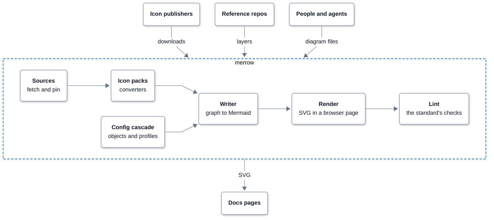
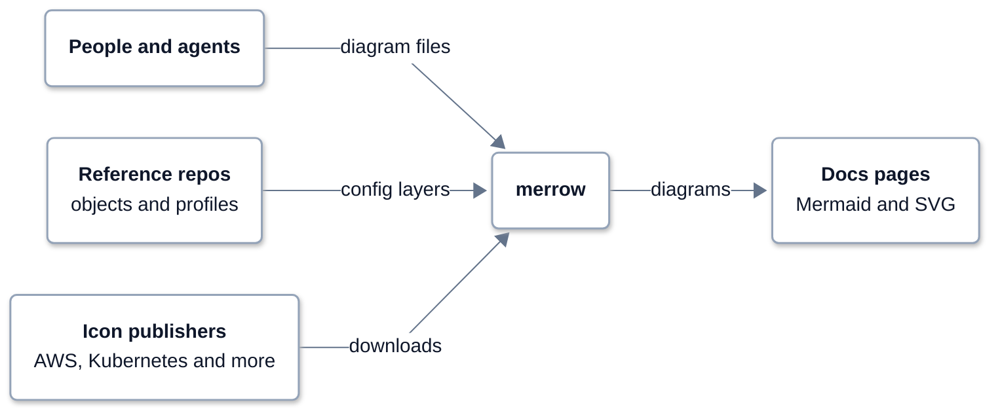

# Architecture

merrow turns a description of a diagram into Mermaid in a fixed look, then renders and checks it. A diagram file goes through the writer, render and lint in that order, fed by icon packs and config.

*Figure 1. L2 Services -- merrow.* Up: [L1 Context -- merrow](#everything-a-company-owns-comes-in-from-outside).

## Components

Each box in Figure 1, where its code lives and what it decides.

| Part | Code | What it decides |
|---|---|---|
| Sources | `src/merrow/sources/`, `sources.yaml`, `sources.lock.yaml` | Which publisher download, pinned by version and checksum, and when a release is out |
| Icon packs | `src/merrow/convert/`, `naming.py` | Each publisher file's icon key and title. The artwork is never changed |
| Config cascade | `config.py`, `profile.py`, `destination.py`, `objects.py` | merrow's defaults, then each reference repo, then `settings.yaml` and `MERROW_*` |
| Writer | `write.py`, `compose.py`, `spec.py`, `patterns.py` | Node labels, classes, groups, rows, stacked boundaries and long chains in stages |
| Render | `render.py`, `post.py`, `bundle.py`, `browser.py` | Mermaid drawn by playwright in light and dark, then group icons placed |
| Lint | `lint/diagram_check.py` | The standard's source checks, then size, crossings and skip arrows on the render |

## Everything a company owns comes in from outside

Authors and agents write diagram files. merrow draws them with publisher icons and the objects and profiles from reference repos, and writes Mermaid and SVG for the docs.

*Figure 2. L1 Context -- merrow.* Up: top of merrow. Down: Figure 1, L2 Services, above.

## A profile is the whole look, and a reference repo can extend one

A profile is a set of DTCG token files plus templates in `profiles.yaml`. `house` is merrow's neutral look. `aws` draws AWS icons at their artwork size with the group styles from AWS's deck. A reference repo adds a token file to restyle a profile, or defines a profile with `extends:` and names just what changes.

## A destination is where the diagram is published

A destination in `destinations.yaml` holds what depends on the page: the column, the width and height limits, and the themes rendered to SVG. `page` is a docs page and the default, and `slide` is a deck. The profile and the destination are set separately, so `aws` lints for a page or a slide with no second profile. A reference repo defines a destination with `extends:`, such as a docs site with a 692 px column.

## Objects are drawn the same everywhere

An object is a thing with a label, a class or an icon, defined once. Every titled icon in a pack that `generated_objects` lists becomes an object by itself, such as `aws.amazon-ec2` from the AWS pack or `k8s.sts` from the Kubernetes one. merrow ships one pack, `starter`: 34 generic Carbon icons drawn as `icon.server` and the like with nothing built, and a built pack of the same name wins over it. A title comes from a `names` rule, or from the source's `titles` map where file names are abbreviations. A reference repo adds its objects, and an entry it writes wins over a generated one. A diagram file can carry its own `objects:` block for things only it draws, and those win for that file alone.

## What merrow won't do

It won't redistribute a publisher's icons: packs are built into a cache outside every repo. It won't draw a group that crosses another, because Mermaid can't. A multi-zone deployment draws one zone labelled with its count.
