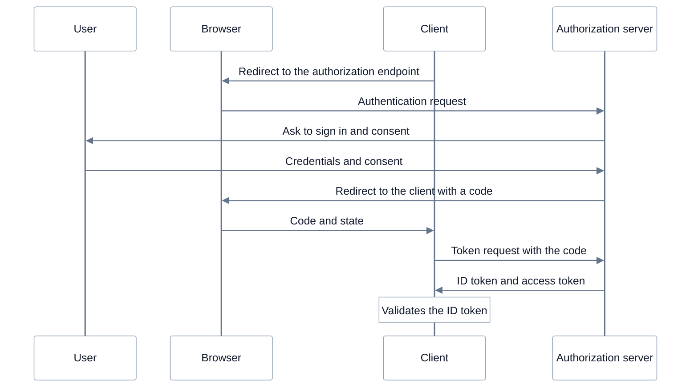

# OpenID Connect login

The authorization code flow in OAuth 2.0 ([RFC 6749 Section 4.1](https://www.rfc-editor.org/rfc/rfc6749#section-4.1), Figure 3) with the steps OpenID Connect adds to it ([OpenID Connect Core 1.0 Section 3.1.1](https://openid.net/specs/openid-connect-core-1_0.html#CodeFlowSteps)). Redrawn from those two texts.

The browser carries the code and never sees a token. The client trades the code for tokens on a direct call that the user can't tamper with. The implicit and hybrid flows are not drawn.

*Figure 1. L4 Detail -- OpenID Connect authorization code login.* Up: [Worked examples](../README.md).
