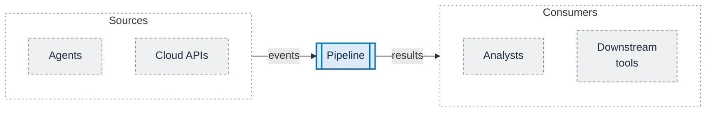
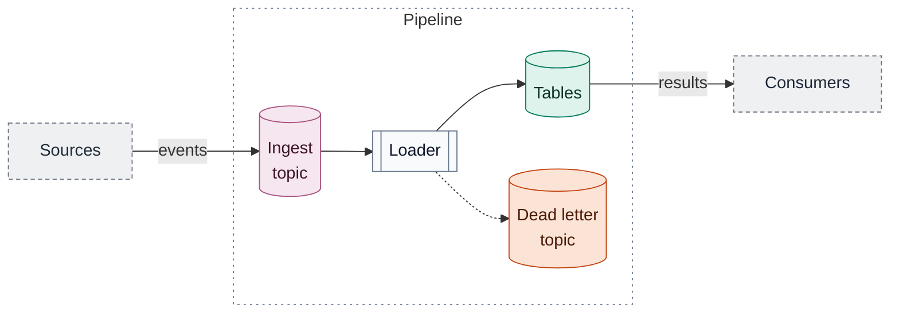
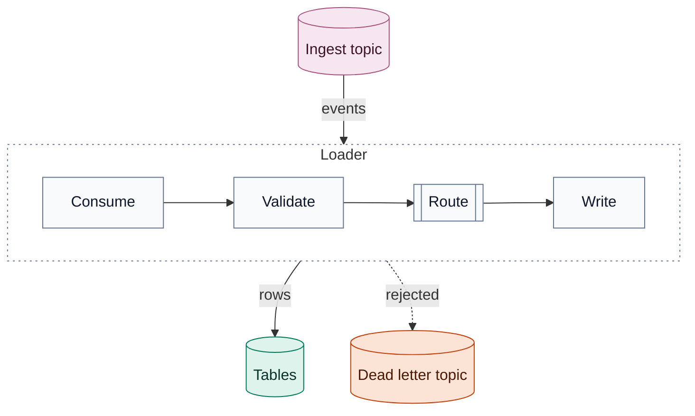
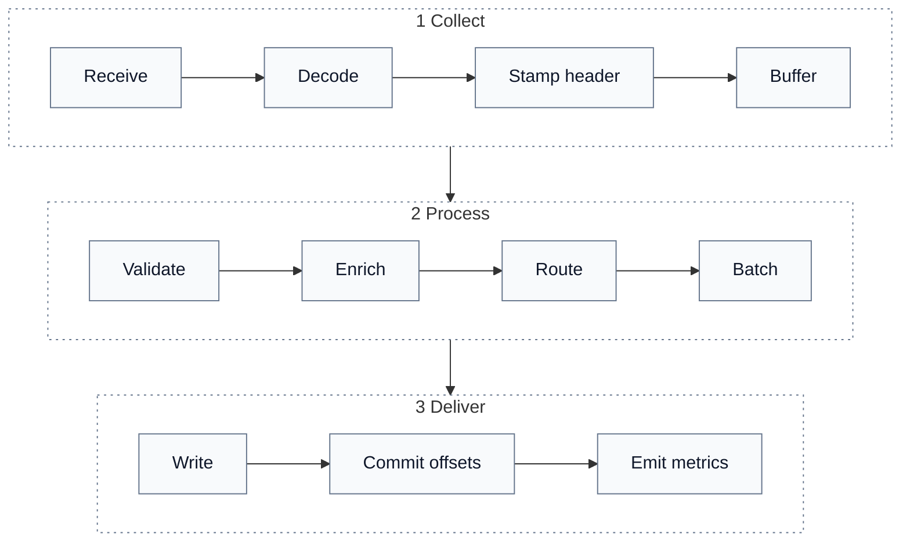
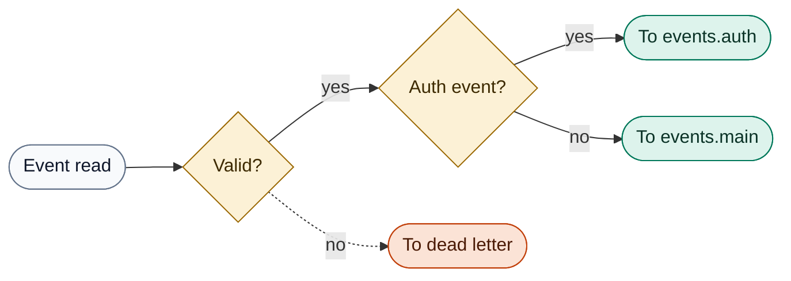
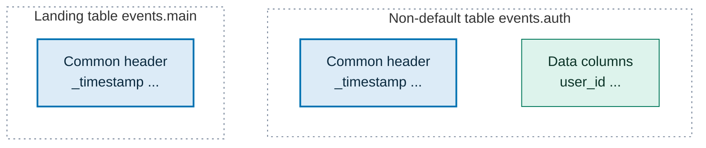
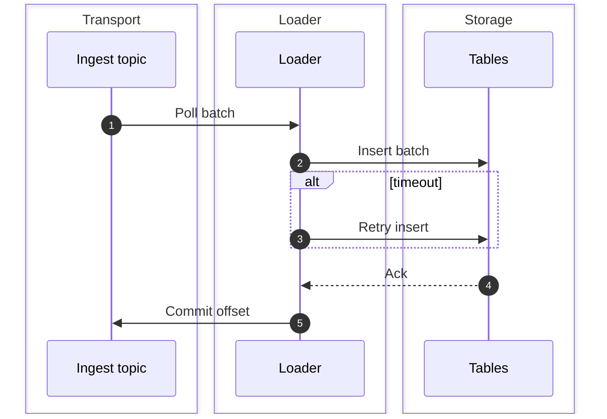
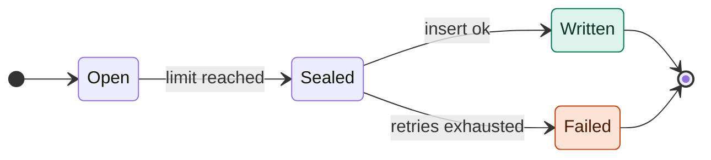

# Diagram templates

One template a level and form, each a whole page block: intro, Mermaid and caption. Start from the one that matches, change the nodes and labels, and keep the structure. `Up` and `Down` are plain text here and links on a page. The rules they follow are in [diagrams.md](diagrams.md).

## L1 Context

The pipeline takes events from agents and cloud APIs and returns results to analysts and downstream tools.

*Figure 1. L1 Context -- Pipeline. Sources and consumers sit outside the pipeline.* Up: L0 Landscape. Down: L2 Services -- Pipeline.

## L2 Services, straight boundary

Every event reaches the pipeline's tables through one topic and the loader.

*Figure 2. L2 Services -- Pipeline. The loader takes the dead letter path only for rejected events.* Up: L1 Context -- Pipeline. Down: L3 Components -- Loader.

## L3 Components, stacked boundary

The loader checks every event before it routes and writes it, so a rejected event never reaches a table.

*Figure 3. L3 Components -- Loader. Rejected events leave from the validate step.* Up: L2 Services -- Pipeline. Down: L4 Detail -- Loader routing decision.

## L4 Detail, stacked stages (pattern B)

The loader's eleven steps fall into three stages: collect, process and deliver.

*Figure 4. L4 Detail -- Loader stages. Read each stage left to right, then down.* Up: L3 Components -- Loader.

## L4 Detail, decision flow

An auth event goes to `events.auth`, any other valid event to `events.main`, and an invalid one to the dead letter topic.

*Figure 5. L4 Detail -- Loader routing decision.* Up: L3 Components -- Loader.

## L4 Detail, side by side (pattern C)

Every table carries the same common header, and only the non-landing tables add data columns.

*Figure 6. L4 Detail -- Common header against a complete table schema. The common header is identical in every table, and non-default tables add data columns.* Up: L3 Components -- Loader.

## L4 Detail, sequence

The loader commits the topic offset only after the batch is in the tables, retrying once on a timeout.

*Figure 7. L4 Detail -- Batch write with retry.* Up: L3 Components -- Loader.

6 participants or fewer, with the labels they have on the L2 and L3 diagrams.

## L4 Detail, state

A batch seals at its size or age limit and ends written, or failed once its retries run out.

*Figure 8. L4 Detail -- Batch lifecycle.* Up: L3 Components -- Loader.
