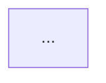

# Diagrams

A picture beats a paragraph: if relating components takes more than two sentences, draw one. Put it next to the prose it illustrates, never in an appendix. Diagrams live in `docs/` `.md` files, never in source comments or file headers.

One look across every project that takes this standard. The same kind of content uses the same diagram type, direction, node outlines and colours in every doc, so a reader who learned one diagram has learned them all. An improvement is a change to this file, or to your own reference repo's, never a private style for one doc.

This file is self-contained. Why each rule exists, with sources and test evidence, is in [docs/diagrams-research.md](https://github.com/hyperi-io/merrow/blob/main/docs/diagrams-research.md).

## The rules

| Rule | What it says |
|---|---|
| R1 | Diagrams are Mermaid, in a fenced `mermaid` block. No ASCII boxes, no box-drawing characters, no image of a diagram. One exception: a diagram its destination's renderer can't draw is published as merrow's SVGs beside its diagram file ("Page wrapper"). On a docs page that is a diagram with icon nodes, because GitHub loads no icon pack. |
| R2 | Diagrams are landscape and read top-left to bottom-right: `flowchart LR`. `flowchart TB` is for the stacked forms, and for two rows such as pairs, where no box both receives and sends an arrow. |
| R3 | 12 nodes or fewer, 5 columns or fewer, one idea, one level. |
| R4 | Zero crossed lines, zero lines through boxes, zero overlapping labels. |
| R5 | Colour comes from the class lines in "Colour", or in "House style", byte for byte. No other colour. |
| R6 | Five node outlines ("Node outlines"), plus the rounded label a house flowchart uses. Nothing else. |
| R7 | Every diagram has `accTitle`, `accDescr` and a caption. The prose beside it carries only what the picture cannot show: why, the limits, what is optional. No sentence restates what the diagram shows, and none announces it. A caption names no colour or line style: the profile sets those, and they change with it. |
| R8 | Every diagram has a level, L0 to L4, and links up to its parent. |
| R9 | No per-diagram configuration: no `%%{init}%%`, frontmatter, `style`, `linkStyle` or `click`. The one exception is the house block in "House style", byte for byte. |
| R10 | Every diagram passes the checker ("Checking"), and its light and dark screenshots are looked at before merge. |

When a diagram cannot meet a rule, split the diagram. An exception is made by changing this file.

## When to draw

A diagram is mandatory for architecture with three or more interacting components, data flow through the system, deployment topology, service-to-service interaction, and anything with lifecycle states.

| Draw a diagram for | Use this instead |
|---|---|
| Flow: data or control moving through steps | A numbered list, for a procedure with no branches |
| Composition: what contains what | A table, for attribute comparisons, field lists and option matrices |
| Interaction: who calls whom, in what order | A table, for wire formats, headers and bit fields |
| State: the lifecycle of one thing | A table, for schedules |

- Every node maps to a component that exists, read out of the code.
- Do not draw a diagram that repeats the paragraph above it.
- ASCII is allowed for directory trees and literal terminal output, nothing else. Terminal output goes in a `console` fence, because a `text` or untagged fence holding box borders, or a line with two or more arrows (`a -> b -> c`), is read as a text diagram.

## Diagram types

| You are showing | Use |
|---|---|
| Structure, flow, architecture, decisions, composition | `flowchart LR` |
| Calls between parts over time | `sequenceDiagram` |
| Lifecycle of one thing | `stateDiagram-v2` with `direction LR` |
| Tables and relationships | `erDiagram`, key columns only |
| Trait, interface or class hierarchies | `classDiagram` |

- These five types, and `flowchart`, never `graph` or `TD`.
- Banned: `gantt`, `packet`, `mindmap`, `timeline`, `C4Context` and every `-beta` type.

## Levels

Every diagram sits at one level. A set of diagrams zooms in one level at a time.

| Level | Name | Shows | A node is | Lives on |
|---|---|---|---|---|
| L0 | Landscape | All products and how they relate | A product | The company docs home, one diagram |
| L1 | Context | One product and what it talks to | The product as one box, people, external systems | The product overview page |
| L2 | Services | The running parts of one product | A deployable service or a data store | The product architecture page |
| L3 | Components | The inside of one service | A module or stage of that service | That service's overview page |
| L4 | Detail | One mechanism | A step, state, message or field | The topic page that explains it |

- L4 is the bottom. Sequence, state, ER and class diagrams are always L4, and so is anything that is not L0 to L3. An L4 that expands a box of another L4 stays L4 and links `Up` to that diagram.
- A repo with one deployable part starts at L2 or L3 and links up to the product's diagram in its own repo. Its top diagram shows its parts inside a boundary and its neighbours outside: L3 for one service, L2 for a repo of several.
- A second view of the same services, such as an event path or deployment layers, is L4 and links Up to the L2.
- A diagram that explains a concept in a standard or a guide, outside any product's parts, is L4. Its `Up` links the page above it in the docs tree.
- A repo's top diagram has no parent to link, so its caption says so: `Up: top of <repo>.`
- `L0` to `L4` name these levels only. A project that numbers its own layers writes `Layer 1`, never `L1`, so the two never read as one scheme.

Title format is `L<n> <Level name> -- <scope>`, for example `L2 Services -- Pipeline`. `accTitle` and the caption both start with it. The caption carries the links:

```text
*Figure 2. L2 Services -- Pipeline.* Up: [L1 Context -- Pipeline](../overview.md). Down: [L3 Components -- Loader](../loader/overview.md).
```

`Up` is mandatory for L1 to L4, and `Down` lists every child diagram. The product architecture page carries a diagram map, a nested bullet list linking every L0 to L3 diagram.

## Parent and child

| Rule | Meaning |
|---|---|
| One level per diagram | A service and one of its internal modules never appear in the same diagram |
| One parent per diagram | An L2 or L3 diagram expands exactly one box from the level above |
| Boundary | The expanded box becomes a subgraph with the parent's label and the `group` class |
| Neighbours | Everything the parent box connected to appears outside the boundary, unexpanded, with the label, outline and class it has on the parent. Neighbours of one kind merge into one node |
| Balance | Every arrow touching the parent box appears on the child crossing the boundary, with the parent's label where it has one. Nothing else crosses. An arrow the parent draws to or from its boundary subgraph counts as touching the box. One parent arrow that reaches several inner nodes attaches to the boundary subgraph. Labels follow each diagram's own boundary, so an arrow that crosses the child's boundary is labelled there even where it is bare on the parent |
| Same thing, same look | A thing keeps its ID, label, outline and class at every level. The one exception is `core`, which marks the subject of the diagram it is on, so a box is `core` there and plain elsewhere |
| Fan-out | 3 to 7 nodes inside the boundary. Fewer than 3 gets no child diagram, and the parent's prose describes it |
| Drill-down marker | A box that has a child diagram uses the subroutine outline `id[["Label"]]`. Like `core`, the marker belongs to the diagram it is on: the child draws the thing as its boundary subgraph, or at L4 as its `core` box in its own outline |
| One home | A diagram exists on one page, and other pages link to it |
| Change together | A change to a boundary arrow updates parent and child in the same PR |

Expand a box only where the docs explain it. Not every box gets a child.

| Boundary form | Use when | Structure |
|---|---|---|
| Straight | 3 inner columns or fewer | `flowchart LR`: neighbour, boundary subgraph, neighbour. Arrows go to the inner node that owns them |
| Straight, arrows on the boundary | 3 inner columns or fewer, where a neighbour reaches two inner nodes at different depths, so arrows to the inner nodes would skip a column | `flowchart LR`: neighbour, boundary subgraph, neighbour. Arrows attach to the boundary subgraph |
| Stacked | More than 3 inner columns | `flowchart TB`: neighbour above, boundary subgraph with `direction LR`, neighbours below. Arrows attach to the boundary subgraph, never to an inner node |

## Layout

| Measure | Limit |
|---|---|
| Proportion | Width at least 1.3 x height |
| Rendered height | 600 px |
| Natural width (SVG `viewBox`) | 1250 px |
| Columns | 5 |
| Nodes | 12 |
| Subgraphs | 4, nested 2 deep |
| Arrows | Node count plus 2 |
| Arrows on one node | 5 |

- The proportion holds flowcharts and state diagrams. A sequence, ER or class diagram is held by the width and height limits alone. A `classDiagram` lays out top to bottom: past the height limit, `direction LR` under its first line lays it across.
- A sequence diagram has 6 participants or fewer, and fits 8 messages under the height limit. Past 8, draw one diagram per path, and write a path of 3 steps or fewer as prose.
- Height is measured as shown on the page: a diagram wider than the 860 px column is scaled down to it.
- The width, height and column are the `page` destination's. A deck is checked with `--destination slide`, and a reference repo defines a destination for a page of another width.
- Start top-left and finish bottom-right. The main path is one straight line. Mermaid centres a node between the branches it feeds, so that line can sit below the top row.
- Branches and failure paths sit below the main path. Parallel things stack vertically in one column.
- A subgraph marks a boundary that exists: a system, a stage, a group of like things. Every subgraph has an ID and a quoted title.
- Never a single-file vertical chain.
- A thing appears once in a diagram. Two flows through the same things are two diagrams. A start or end stadium is a point in the flow, not a thing: two paths that end the same way, such as a decision's "no" and a later failure, each take their own end node with the same label. One shared end node would need a skip or back arrow.
- A decision diamond is wider than a box. Three decisions in a row fit the width, and a start node in front of them does not. A chain of more than 3 decisions splits after the third into a second diagram, which starts at the node the first one ends on.

| Pattern | Use when | Structure |
|---|---|---|
| A, straight flow | 5 columns or fewer | `flowchart LR` |
| B, stacked stages | A chain longer than 5 steps | `flowchart TB` of 2 to 4 stage subgraphs, each `direction LR`, linked subgraph to subgraph |
| C, side by side | Composition or comparison with no flow | `flowchart LR`, subgraphs joined with invisible `~~~` links. Mermaid lays arrowless members out as an uneven grid, so each subgraph takes `direction LR` and chains its members with `~~~` |

A subgraph's `direction` stops working the moment a node inside it links to a node outside it. Link the subgraphs themselves.

Every path stays on the diagram, optional ones included. An optional step is its own stage group, and optional paths are dotted arrows (`-.->`) from group to group, a bypass included with its label. The main path stays solid. Where that widens the diagram, split the groups smaller.

## Lines

Clean lines come from where the boxes are. Fix the boxes, never the lines.

Before writing any Mermaid, write the column plan. A node's column is one to the right of its furthest-right source. Order each column top to bottom so a node sits on the row of the node that feeds it. The main path is declared first, so it takes the top row of the plan.

```text
col 1: sources
col 2: topic
col 3: loader
col 4: tables, dlq
col 5: consumers
```

| Rule | Meaning |
|---|---|
| One column at a time | Every arrow goes from one column to the next column on its right |
| No skip arrows | An arrow that jumps a column is deleted, or its target moves |
| No back arrows | One feedback loop per diagram at most, dotted, declared last |
| No shared pairs | Two nodes in one column never both point at the same two nodes in the next column, because those lines must cross. Group the targets in a subgraph and point at it, or put a hub that exists (a topic, a gateway) between them |
| One arrow per group | When every member of a subgraph gets the same arrow, draw one arrow to or from the subgraph |
| Triangles | When `a` uses `b` and `c`, and `b` uses `c`, the arrow from `a` to `c` skips a column. `b` and `c` are a group of like things: put them in a subgraph named for what they share (`Libraries`), with one arrow from `a` to it |
| Label siblings alike | Mermaid draws a labelled arrow one column longer than a plain one. When one arrow out of a box, or into it, is labelled, label the others on that side of the box too, or a box lands a column further out and an arrow becomes a skip arrow. This is the one case where an arrow outside the label rule in "Text" takes a label |
| One direction per arrow | No double-headed arrows |
| One arrow per pair | Two arrows between the same two boxes in opposite directions lie on top of each other. For a request and its response, split the box into an intake box and a return box |
| Line styles | Solid `-->` for the main path. Dotted `-.->` for async, optional or failure. Thick `==>` is banned |

The order of the source controls the layout. Write nodes and subgraphs in reading order, column 1 top to bottom, then column 2. Write arrows in the same order, then the feedback arrow, then the class lines, then the class assignments. One arrow per line. A chain (`a --> b --> c`) is allowed for a straight run inside a stage subgraph.

## Repair ladder

When the rendered diagram has a crossing, a line through a box or an overlapping label, apply these in order. Render again after each step and stop when it is clean.

1. Reorder the node declarations in the column where the lines cross, to match the row order of the column before it.
2. Reorder the arrow declarations to match. Where the main path still lands below its branches, try the arrows in reverse order: Mermaid sometimes stacks the first-declared path lowest.
3. Delete skip arrows.
4. Replace per-member arrows with one arrow to the subgraph.
5. Break up a shared pair: group the targets or add a hub that exists.
6. Pin two nodes next to each other with an invisible link: `a ~~~ b`. Inside a subgraph, declaration order does not bind, so a `~~~` chain is how to set the order there. A node with no incoming arrow lands in column 1: pin it to the node it belongs beside. In a `direction LR` subgraph a chain lays its members across, so to stack them in order give that subgraph `direction TB` as well.
7. Shorten or delete the colliding label.
8. Split the diagram.

Never fix lines with `linkStyle`, curve settings, layout configuration, empty spacer nodes or a longer link (`a ---> b`), which is a skip arrow where Mermaid honours it.

## Node outlines

| Concept | Outline | Syntax |
|---|---|---|
| Process, service, component, person, external system | Rectangle | `id["Label"]` |
| Data at rest: table, topic, queue, bucket, database | Cylinder | `id[("Label")]` |
| Decision | Diamond | `id{"Question?"}` |
| Start or end of a flow | Stadium | `id(["Label"])` |
| Box that has a child diagram | Subroutine | `id[["Label"]]` |

- Four outlines or fewer in one diagram.
- External systems and people are rectangles with the `ext` class, whose dashed border marks them without colour.
- Banned: rounded boxes, hexagons, circles, trapezoids, parallelograms, flags, images and the `id@{ shape: ... }` syntax.
- Icons only as merrow draws them. Where the profile draws icons, a node whose object has an icon in a built pack becomes `id@{ icon: ... }`, its label under it. Name the object in the diagram file and let merrow write the node. Lint passes an icon node only under such a profile, and only for an icon a built pack holds.

## Colour

Colour encodes a role, never decoration. Each class means one thing in every diagram.

| Class | Means | Fill | Border | Text |
|---|---|---|---|---|
| `default` | Ordinary step or component | `#F8FAFC` | `#64748B` | `#0F172A` |
| `core` | The one box this diagram is about | `#DCEBF7` | `#0072B2` | `#0B2A3F` |
| `store` | Data that stays: table, bucket, database | `#DDF3EC` | `#00785A` | `#0B3327` |
| `async` | Data in transit: queue, topic, asynchronous hand-off | `#F6E6EF` | `#A8517F` | `#3D1529` |
| `decision` | Decision | `#FCF1D6` | `#9A6700` | `#3D2A00` |
| `error` | Failure path, dead letter | `#FBE3D6` | `#C2410C` | `#4A1A05` |
| `ext` | Outside our control, dashed border | `#EEF0F2` | `#6B7280` | `#1F2937` |
| `group` | Subgraph boundary, no fill, dotted border | none | `#64748B` | site theme |

Copy the lines a diagram uses to the end of the flowchart, byte for byte. A flowchart always includes `default`. A `stateDiagram-v2` takes only the lines it uses and never `default`, which fails to parse there. Never edit a line or add one.

```text
    classDef default fill:#F8FAFC,stroke:#64748B,stroke-width:1px,color:#0F172A
    classDef core fill:#DCEBF7,stroke:#0072B2,stroke-width:2px,color:#0B2A3F
    classDef store fill:#DDF3EC,stroke:#00785A,stroke-width:1px,color:#0B3327
    classDef async fill:#F6E6EF,stroke:#A8517F,stroke-width:1px,color:#3D1529
    classDef decision fill:#FCF1D6,stroke:#9A6700,stroke-width:1px,color:#3D2A00
    classDef error fill:#FBE3D6,stroke:#C2410C,stroke-width:1px,color:#4A1A05
    classDef ext fill:#EEF0F2,stroke:#6B7280,stroke-width:1px,stroke-dasharray:4 3,color:#1F2937
    classDef group fill:none,stroke:#64748B,stroke-width:1px,stroke-dasharray:2 4
```

- Apply with `class a,b store`. Apply `group` to every subgraph.
- 4 colour classes or fewer in one diagram, plus `default` and `group`. Most nodes stay `default`.
- `core` goes on one thing: the product at L1, the item being explained at L4. A comparison that draws that thing twice colours both. L2 and L3 do not use `core`, because the boundary is the subject.
- The outline says a box holds data, and the class says which kind. A queue or topic is a cylinder with `async`, a table or database a cylinder with `store`, a dead letter queue a cylinder with `error`. A store that is the diagram's subject stays a cylinder and takes `core` in place of its data class.
- Every other class stays with its thing at every level.
- Colour never carries meaning alone. The outline or the label says the same thing.
- Arrows, arrow labels, subgraph titles and the background are never coloured. The site theme owns them.
- `stateDiagram-v2` copies the `classDef` lines it uses. `sequenceDiagram`, `erDiagram` and `classDiagram` take no colour at all: `box Title` with no colour value.

Every node carries its own fill, border and text colour, so it reads the same on the three canvases a diagram is published to: white, GitHub dark `#0D1117` and the docs site dark `#1B1B1D`. Every border is 3:1 or better against all three, and every text colour is 11:1 or better on its fill.

## House style

A diagram may carry the house block in place of the role palette: the frontmatter, the class lines and the boundary lines below, copied byte for byte. A block that differs by one character fails R9. merrow generates the block from the house profile's tokens, and `merrow profile show house` prints it. A main part of the data flow takes its class by what it does: `ingest` takes data in, `xform` changes it, `load` writes it, `bus` carries it, `store` keeps it and `ui` shows it. Everything else takes a role class (`control`, `part`, `decision`, `error`, `ext`). A reference repo maps its own components onto these classes as objects.

A house flowchart opens with this frontmatter:

```yaml
---
config:
  theme: base
  look: neo
  fontFamily: Inter, -apple-system, Segoe UI, Roboto, Helvetica, Arial, sans-serif
  flowchart:
    curve: linear
    nodeSpacing: 40
    rankSpacing: 64
    padding: 18
    wrappingWidth: 280
    htmlLabels: true
  elk:
    preset: modelOrder
  themeVariables:
    fontSize: 15px
    lineColor: "#64748B"
    primaryTextColor: "#0F172A"
    nodeBorder: "#334155"
    clusterBorder: "#0072B2"
    edgeLabelBackground: "#FFFFFF"
  themeCSS: >-
    p{margin:0}
    .node[data-look] rect,.node[data-look] path,.node[data-look] polygon,.node[data-look] .outer-path{filter:drop-shadow(0 1px 2px rgba(15,23,42,.10)) drop-shadow(0 6px 14px rgba(15,23,42,.10))}
    .node rect{rx:10px;ry:10px}
    .cluster rect{rx:16px;ry:16px}
    .node .label div{min-width:150px}
    .node.decision .label div{min-width:0}
    .cluster[data-look] rect{filter:none}
    .nodeLabel{line-height:1.35}
    .nodeLabel b{font-weight:600;font-size:15px;letter-spacing:-0.01em}
    .nodeLabel span{font-size:12.5px;font-weight:400;color:#334155}
    .cluster-label span.nodeLabel{display:inline-block;background:#FFFFFF;color:#0B2A3F;border:1.5px solid #0072B2;border-radius:999px;padding:2px 12px;font-size:11.5px;font-weight:700;letter-spacing:.09em;text-transform:uppercase}
    .flowchart-link{stroke-width:1.75px}
    .labelBkg{background:transparent!important}
    span.edgeLabel{display:inline-block;background:#FFFFFF!important;color:#1E293B;border:1px solid #94A3B8;border-radius:999px;padding:2px 10px;font-size:12px;font-weight:500}
    span.edgeLabel p{background:transparent!important}
    .label-icon{width:20px;height:20px;vertical-align:-4px;margin-right:6px}
    .icon-shape path[stroke-width="0"][fill="none"]{fill:#FFFFFF;stroke:#FFFFFF;stroke-width:12px;stroke-linejoin:round}
    .icon-shape p{background:transparent!important;color:#0F172A}
    .ingest .label-icon{color:#0E8A7D}
    .xform .label-icon{color:#7B4FB0}
    .load .label-icon{color:#0072B2}
    .bus .label-icon{color:#A8517F}
    .store .label-icon{color:#00785A}
    .ui .label-icon{color:#D9480F}
    .ext .label-icon{color:#64748B}
---
```

A house sequence, state or ER diagram opens with this one:

```yaml
---
config:
  theme: base
  fontFamily: Inter, -apple-system, Segoe UI, Roboto, Helvetica, Arial, sans-serif
  themeVariables:
    fontSize: 15px
    lineColor: "#64748B"
    primaryTextColor: "#0F172A"
    actorBkg: "#FFFFFF"
    actorBorder: "#94A3B8"
    actorTextColor: "#0F172A"
    actorLineColor: "#64748B"
    signalColor: "#64748B"
    signalTextColor: "#0F172A"
    noteBkgColor: "#FFFFFF"
    noteBorderColor: "#94A3B8"
    noteTextColor: "#0F172A"
  themeCSS: >-
    .messageText{paint-order:stroke;stroke:#FFFFFF;stroke-width:3px;stroke-linejoin:round}
---
```

A house flowchart ends with all eleven class lines:

```text
  classDef ext fill:#F4F6F8,stroke:#94A3B8,stroke-width:1.5px,stroke-dasharray:5 4,color:#0F172A
  classDef ingest fill:#FFFFFF,stroke:#0E8A7D,stroke-width:3px,color:#0F172A
  classDef xform fill:#FFFFFF,stroke:#7B4FB0,stroke-width:3px,color:#0F172A
  classDef load fill:#FFFFFF,stroke:#0072B2,stroke-width:3px,color:#0F172A
  classDef bus fill:#FFFFFF,stroke:#A8517F,stroke-width:3px,color:#0F172A
  classDef store fill:#FFFFFF,stroke:#00785A,stroke-width:3px,color:#0F172A
  classDef ui fill:#FFFFFF,stroke:#D9480F,stroke-width:3px,color:#0F172A
  classDef decision fill:#FFFFFF,stroke:#9A6700,stroke-width:3px,color:#0F172A
  classDef error fill:#FFFFFF,stroke:#C2410C,stroke-width:3px,color:#0F172A
  classDef control fill:#FFFFFF,stroke:#334155,stroke-width:3px,color:#0F172A
  classDef part fill:#FFFFFF,stroke:#94A3B8,stroke-width:1.5px,color:#0F172A
```

- Each subgraph takes one boundary line with its own id: `style <subgraph-id> fill:none,stroke:#0072B2,stroke-width:1.5px,stroke-dasharray:6 4`. A boundary line naming no subgraph draws a phantom node.
- Labels take the HTML form `id("<b>name</b><br/><span>subtitle</span>")`. That rounded box is allowed only in a house flowchart.
- A house flowchart takes no `default` class line, and the 4-class limit does not apply.
- A house state diagram takes its class lines from "Colour". Sequence and ER diagrams still take no colour.
- `#7B4FB0` is 2.9:1 on `#1B1B1D`, under the 3:1 border floor. It reads because the white fill sits inside it.

## Text

- Node labels are 1 to 4 words, sentence case, 2 lines at most with `<br/>`, and always quoted: `id["Label"]`. An identifier (`events.main`) is allowed when the identifier is the point.
- Mermaid wraps a line again when it runs past the box's width, often at about 15 characters, so a 2-line label can show on 3. A name with no space breaks mid-word, often at a hyphen. Shorten the line, and let the checker confirm it.
- Node IDs are meaningful and lowercase: `loader`, `dlq`. Never `A`, `B`, `C`. A generated ID is the name with `-` and `.` replaced by `_`. In a state diagram the state's name is its label, so it takes sentence case: `Open`.
- Arrow labels are 1 to 2 words, with no parentheses or quotes. Every branch out of a decision is labelled. An arrow that crosses the diagram's boundary or touches the `core` box is labelled with what moves. No other arrow is labelled. A split chosen by configuration or by when it runs (local path or object store, every run or on release) is a decision: draw the diamond and label its branches.
- No fonts, emoji or HTML, and no icon except an icon node (Node outlines). `<br/>` is the one tag.
- Notes and annotations go in a paragraph or a table under the caption, never in the diagram and never as extra caption sentences.

## Page wrapper

Every diagram is written like this.

````markdown
Every event reaches the pipeline's tables through one topic and the loader.



*Figure 2. L2 Services -- Pipeline. Sources and consumers sit outside the pipeline.* Up: [L1 Context -- Pipeline](../overview.md). Down: [L3 Components -- Loader](../loader/overview.md).
````

- An intro sentence before, a caption after.
- The intro states what the reader takes from the diagram, as a claim the diagram backs. It never announces the diagram: no "This diagram shows" or "Below is".
- `accTitle` is one line, the title.
- `accDescr` is one line of plain sentences with no colons.
- The caption is `Figure N.`, the title, one sentence for any colour or line style the reader could not guess, then the links.
- A repo whose formatter rewrites `*...*` emphasis to `_..._`, as prettier does, writes the caption in italics its way. The checker reads both forms.
- An `Up` or `Down` link to a page's top diagram links the page itself, never its H1 anchor: a docs site turns the H1 into the page title, and the anchor does not exist there.

A diagram the destination's renderer can't draw goes in as images in place of the fence, one a theme. On a docs page that is a diagram with icon nodes. `merrow graph render --page` prints the lines. GitHub shows the one whose fragment matches the reader's theme. The alt text is the title and the `accDescr` sentences. A docs site shows both until its CSS hides one. Docusaurus needs this rule in its custom CSS:

```css
[data-theme='light'] img[src$='#gh-dark-mode-only'],
[data-theme='dark'] img[src$='#gh-light-mode-only'] {display: none}
```

```markdown


```

- The diagram file sits beside the SVGs and is the source. `merrow graph render` writes both SVGs and the `.mmd` from it, and lint runs on that `.mmd`.
- Change the file and render again. Never edit an SVG.
- A link to the diagram file names the file, never its directory: Docusaurus fails its build on a directory link.

## Templates

One template a level and form is in [diagram-templates.md](diagram-templates.md). Start from the one that matches.

## Charts and images

Mermaid draws flows and structure. Anything plotted from data or from a function is a matplotlib chart, saved as SVG, committed beside the script that makes it.

- One script per chart or per set, in `docs/img/`, with its dependencies in a PEP 723 block pinned `==`. Regenerate with `uv run docs/img/<name>.py`. Name that command in the doc.
- Output SVG, never PNG, unless the data is dense enough to push the file past the size limit.
- Set `svg.hashsalt` and `metadata={"Date": None}` so two runs are byte-identical and a drift check can compare them.
- Write two files, `<name>-light.svg` and `<name>-dark.svg`, from the one script. Canvases are `#FFFFFF` and `#0D1117`. No single grey reaches 4.5:1 on both, so one transparent image fails for text. Text meets 4.5:1 and lines meet 3:1 on their canvas.
- Embed with `<picture>`. The `` carries the light file and the `alt`.
- Alt text is required. State what the chart shows and the conclusion, not "a chart".
- Under 100 KB per SVG. Over it, thin the points or `rasterized=True` the dense layer. Relative paths on GitHub, absolute URLs for a README that leaves GitHub.
- Colour encodes a category and never stands alone, as in a diagram.
- The chart palette is this table, and a script copies its values. Categories run in order, 4 at most. Lines meet 3:1 and ink meets 4.5:1 on their canvas.

| Value | Light | Dark |
|---|---|---|
| Canvas | `#FFFFFF` | `#0D1117` |
| Ink: text, axes, ticks | `#0F172A` | `#E6EDF3` |
| Category 1 | `#0072B2` | `#56B4E9` |
| Category 2 | `#009E73` | `#009E73` |
| Category 3 | `#CC79A7` | `#CC79A7` |
| Category 4 | `#000000` | `#0072B2` |

```html
<picture>
  <source media="(prefers-color-scheme: dark)" srcset="img/sigmoid-dark.svg">
  
</picture>
```

```python
# /// script
# dependencies = ["matplotlib==3.11.2", "numpy==2.5.4"]
# ///
"""Run: uv run docs/img/sigmoid.py"""

import matplotlib.pyplot as plt
import numpy as np

THEMES = {
    "light": ("#FFFFFF", "#0F172A", "#0072B2"),
    "dark": ("#0D1117", "#E6EDF3", "#56B4E9"),
}
x = np.linspace(-6, 6, 200)
for name, (bg, ink, line) in THEMES.items():
    rc = {"svg.hashsalt": "docs", "figure.facecolor": bg, "axes.facecolor": bg}
    rc |= {
        k: ink
        for k in (
            "text.color",
            "axes.labelcolor",
            "axes.edgecolor",
            "xtick.color",
            "ytick.color",
        )
    }
    with plt.rc_context(rc):
        fig, ax = plt.subplots(figsize=(6, 3))
        ax.plot(x, 1 / (1 + np.exp(-x)), color=line, linewidth=2)
        ax.set(xlabel="x", ylabel=r"$\sigma(x)$")
        fig.savefig(f"docs/img/sigmoid-{name}.svg", metadata={"Date": None})
```

## Checking

Nobody writing Mermaid can see the layout from the source. The checker renders each diagram with Mermaid in Chrome and reports what a reader would see.

```text
merrow diagram lint docs/page.md
```

| Pass | Reads | Reports |
|---|---|---|
| Source | The Mermaid text and the page lines around it | Type and direction, `accTitle` and `accDescr`, intro sentence and caption, class lines against "Colour", banned syntax, a fence the destination's renderer can't draw, text diagrams (box borders or arrow chains) in `text` and untagged fences |
| Render | The laid-out SVG | Size and proportion for every type. For flowcharts: node, subgraph and arrow counts, crossed lines, lines through boxes, overlapping labels, skip arrows, arrows against the flow, boxes with no arrow, no `~~~` link and no subgraph, and labels that wrap past 2 lines or break a name mid-word. State diagrams get the same line checks except the back-arrow limit, because a state machine loops. Sequence diagrams: an autonumber badge on a label or another badge |

- A page has every `mermaid` fence checked. A `.mmd` file is one diagram with no wrapper.
- Sequence, state, ER and class diagrams get the source pass and the size checks. Their lines are not measured.
- `merrow graph render` writes a light and a dark SVG of each diagram to look at. `--no-render` runs the source pass alone, on a host with no Chrome.
- Each finding opens with its id in brackets, such as `[skip-arrow]`. A profile drops a finding for its diagrams by listing the id under `lint.waive`. A finding on the page, such as `[figure-numbers]`, belongs to no profile and can't be waived.
- Each verdict line gives a diagram's size and counts, and the last line names the Mermaid release they were laid out with. Layout differs between Mermaid releases, so merrow pins the release in its npm lock file.
- It does not see lines that run on top of each other, contrast, or whether a node exists in the code. Those stay with the reviewer.

## Review checklist

Review the rendered diagram, never the source. Every answer is yes, or the diagram does not merge.

| Area | Questions |
|---|---|
| Reading | Can I say what it shows in one sentence without reading the prose? Is it plain where to start and where it ends? Is every label readable at normal zoom? |
| Layout | Landscape, fully visible without scrolling? Main path straight along the top? No long thin strip, no large empty quarter? |
| Lines | Zero crossings? Zero lines through boxes? Zero overlapping labels? No arrow pointing back, apart from one dotted feedback loop? |
| Colour | Class lines byte-identical to this file, 4 colour classes or fewer? Still makes sense in greyscale? Readable in light and dark mode? |
| Hierarchy | One level? Title, `Up` link and `Down` links present? Boundary arrows, labels, outlines and classes match the parent diagram? |
| Wrapper | Intro sentence, `accTitle`, `accDescr`, caption? |
| Truth | Does every node trace to a component in the code? |

## For agents

merrow ships the agent procedure as a skill, [src/merrow/skill/SKILL.md](https://github.com/hyperi-io/merrow/blob/main/src/merrow/skill/SKILL.md). `merrow skill install` puts it, this file and the templates where Claude Code loads skills.

## Common mistakes

| Mistake | Fix |
|---|---|
| Boxes drawn with `+--+` or box-drawing characters | Mermaid |
| `graph TD` | `flowchart LR` |
| One long chain | Pattern B, stages of 3 to 4 steps |
| 6 or more columns, tiny text | Stack parallel nodes, drop arrow labels, or use pattern B |
| Arrows written before the layout is planned | Column plan first |
| Arrow that jumps over a column | Delete it or move the target |
| Arrow pointing back to the left | Reverse it to the direction data moves, or delete it |
| Two sources each pointing at the same two targets | Group the targets, point at the subgraph |
| The same arrow drawn to every member of a group | One arrow to the subgraph |
| Arrows from inner nodes of a `direction` subgraph to outside nodes | Link the subgraph |
| Messy lines fixed with `linkStyle` or config | Repair ladder |
| A service and its internals in one diagram | Two diagrams, two levels |
| Child diagram with new neighbours or new boundary arrows | Match the parent, or change the parent |
| The same thing renamed or recoloured between levels | Same ID, label, outline and class everywhere |
| No colour, or a different colour on every node | Classes by role, 4 or fewer, most nodes `default` |
| Made-up hex colours, or `fill` without `color` | Class lines from this file |
| Coloured `box` or `rect` in a sequence diagram | `box Title`, no colour |
| Node IDs `A`, `B`, `C` | `loader`, `dlq` |
| Sentences inside nodes | 1 to 4 words, detail goes in prose |
| Unlabelled decision branches | `-->\|yes\|` and `-->\|no\|` |
| Labels on every arrow | Branches and boundary arrows |
| Notes as extra nodes | Caption |
| Double-headed arrows | One arrow, the direction data moves |
| Emoji, HTML | Plain text and `<br/>` |
| A hand-written icon or `@{ shape: ... }` node | The object in the diagram file, which merrow draws as an icon node |
| No `Up` link | Every L1 to L4 diagram names its parent |

## Syntax traps

- Quote every node label. Unquoted parentheses, colons, slashes and brackets break the parser.
- A pipe arrow label (`-->|label|`) takes neither parentheses nor quotes.
- Never use lowercase `end` as a node ID or label. It closes a subgraph. `class` as a node ID fails to parse.
- An HTML entity such as `&#123;` shows literally. Write the character inside the quoted label.
- Keep a space after an arrow. A node ID starting with `o` or `x` straight after a link becomes a circle or cross arrowhead.
- Line breaks are `<br/>`, not `\n`.
- Every subgraph has an ID and a quoted title: `subgraph tables["Tables"]`.
- `accTitle` and `accDescr` are one line each.
- In a `sequenceDiagram`, `;` ends a statement, inside a `Note` too. Write a comma.
- With `autonumber`, a self-message's label lands on its badge. Write the step as a `Note over` that participant, or leave `autonumber` out.
- Comments start with `%%` on a line of their own.
- An arrow that ends on a subgraph makes Mermaid drop that subgraph's `direction`, and its members stack. Chain them with `~~~` to lay them across in order.
- A misspelt keyword can fail silently. The screenshot is the proof that a class applied.

## Generated diagrams

Rules for a tool that EMITS Mermaid, on top of everything above.

1. Sort nodes and arrows before emitting, so two runs are byte-identical and a drift check can compare them.
2. A generated fence sits between markers on a hand-written page (`<!-- <tool>:begin <name> -->` and `<!-- <tool>:end <name> -->`). The generator rewrites what is between them, so the prose stays human. The intro sentence and the caption sit outside the markers.
3. An empty pair is a block too, which is how a page asks for a diagram it never held. A begin with no matching end raises and names it.
4. Collapse repeated arrows of one kind between the same two nodes into one arrow with a count (`x3`). A generated dependency graph may label an arrow this way. Consumers that get the same set of arrow labels from one producer become one subgraph, with one arrow per label.
5. A graph too large for one diagram is split. Its membership, the nodes grouped by an attribute a node holds once, is a generated table: one row per group, its members in one cell. An overview diagram per group can sit beside the table, never in place of it. The arrows go in one diagram per producer, each inside the node limit. A hand-drawn dependency graph past the limits is the same: a diagram of its tiers, and a table of edges (from, to) for the exact arrows.
6. A drift check regenerates every block and compares. It runs in CI, and runs the checker's source pass (`--no-render`) on the page.
7. Ship tests for an idempotent render, an empty pair rendering, an unmatched marker raising, class lines byte-identical to this file, no `(` or `"` in a pipe label, and the live page in sync.
8. A generator's house block is the profile's. It reads `merrow profile show <profile>` when it runs, or keeps a copy with a test that compares the copy with that output. When the profile changes, change the generator: `merrow diagram apply` on the page alone leaves the page out of step with it.

Prose beside a generated diagram says what the picture cannot: why an arrow is lockstep, which member is optional, what is not drawn.
